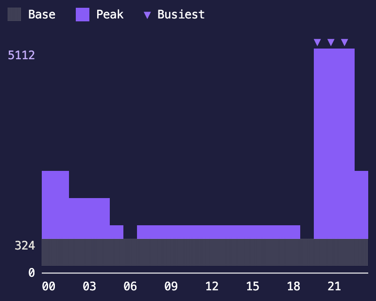
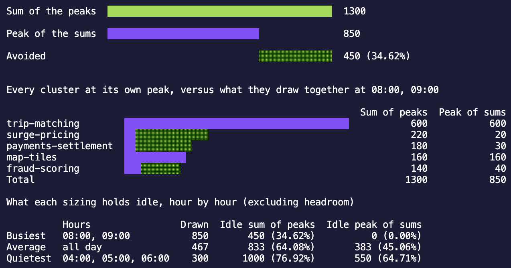

# u9n
Size for the peak of the sum, not the sum of the peaks.

...and then size for less than that.

### Usage

Three subcommands, all reading the same csv.

| Command | What it answers |
| --- | --- |
| `u9n size` | How much vCPU the estate needs, sized three ways. |
| `u9n profile` | What the estate draws each hour of the day. |
| `u9n peak` | How much of the sum of the peaks is never drawn at once. |

#### size

```sh
u9n size --config _examples/quant-fund.csv --headroom 20 --growth 15 --years 3
```

| Flag | Default | Description |
| --- | --- | --- |
| `--config` | | Path to the csv file containing cluster vcpu data. Required. |
| `--headroom` | `20` | Percentage of spare capacity to add on top of peak utilisation. |
| `--growth` | `0` | Expected annual growth in vcpu demand, as a percentage. |
| `--years` | `1` | Number of years to compound growth over. |
| `--format` | `table` | Output format, one of `table`, `json` or `graph`. |

<p align="center">
  
</p>

#### profile

```sh
u9n profile --config _examples/quant-fund.csv --base --peak --format graph
```

| Flag | Default | Description |
| --- | --- | --- |
| `--config` | | Path to the csv file containing cluster vcpu data. Required. |
| `--base` | `false` | Show the vcpu the estate holds around the clock. |
| `--peak` | `false` | Show the vcpu the peak windows add on top of the base. |
| `--format` | `table` | Output format, one of `table`, `json` or `graph`. |

<p align="center">
  
</p>

#### peak

```sh
u9n peak --config _examples/quant-fund.csv
```

| Flag | Default | Description |
| --- | --- | --- |
| `--config` | | Path to the csv file containing cluster vcpu data. Required. |

<p align="center">
  
</p>

### Config

A csv file with one row per cluster. Column order doesn't matter.

| Column | Required | Description |
| --- | --- | --- |
| `name` | yes | Cluster name. Must be unique. |
| `provisioned_vcpu` | yes | vCPU the cluster has today. |
| `peak_vcpu` | yes | vCPU the cluster uses at peak. |
| `base_vcpu` | no | vCPU the cluster uses outside its peak window. Defaults to `0`. |
| `peak_from` | with `peak_to` | Hour the peak window opens, `0`-`23`. |
| `peak_to` | with `peak_from` | Hour the peak window closes, `0`-`24`. |

```csv
name,provisioned_vcpu,peak_vcpu,base_vcpu,peak_from,peak_to
crm-app,24,18,4,9,17
batch-etl,16,11,3,22,3
monitoring,6,6,6,0,0
```

Peak windows are half-open, so `9` to `17` covers 09:00 until 16:59. A window may wrap midnight (`22` to `3` covers 22:00 until 02:59), and a window whose bounds are equal covers the whole day. Omit `peak_from` and `peak_to` entirely and every cluster is treated as permanently at peak.

All hours are assumed to be in the same timezone. Normalise to UTC before writing the config if the estate spans regions.

### Output

```sh
u9n size --config _examples/quant-fund.csv --headroom 40 --growth 15 --years 3
```

```text
Clusters:          14
Provisioned vCPU:  18576
Headroom:          40%
Growth:            15% a year over 3 years (52.09% in total)
Peak diversity:    45.08%

               Current    Worst case      Hour aware
Required vCPU  18576      19819           10885
Peak vCPU      9308       9308            5112
Utilisation    50.11%     46.97%          46.96%
Peak hours     -          -               20:00, 21:00, 22:00
Saved vCPU     0 (0.00%)  -1243 (-6.69%)  7691 (41.40%)
```

**Current** is the status quo, sized by what's already racked rather than by demand, so headroom and growth don't move it. It's the baseline the savings are measured against.

**Worst case** is the sum of every cluster's peak. It assumes they all peak at the same instant, so it has no peak hour.

**Hour aware** walks the 24 hour clock, adds up what every cluster draws in each hour, and takes the busiest. Every hour tied for the busiest is listed. Without peak windows in the config every hour is identical, so the column repeats the worst case and the peak hours read `all day`.

**Peak diversity** is the share of the worst case total avoided by peaks falling in different hours.

Required vCPU is the peak figure, grown by `--growth` compounded over `--years`, plus `--headroom`, rounded up. Peak vCPU is today's demand, so growth shows up in the required row only.

Utilisation is peak demand against the capacity that sizing stands up, not against today's estate. Headroom is what holds the figure below 100%.

Saved vCPU goes negative when a sizing asks for more than is already racked, as the worst case does above: at that headroom and that much growth, consolidating on the assumption every cluster peaks together would cost capacity rather than release it.

### Reading the result

Treat the two consolidated sizings as bounds, not as alternatives:

- **Worst case is the upper bound.** It assumes perfect correlation between clusters.
- **Hour aware is the lower bound.** It assumes the peak windows are exact and that jobs never overrun.

Peak windows are human estimates. A batch job that slips an hour collides with a window the model says it misses, so real demand sits between the two. Size above the hour aware figure unless the windows are backed by measurement.

Some things the tool deliberately doesn't model, each of which can move the answer more than headroom does:

- **Physical cores.** Output is vCPU. The core count to buy depends on the hypervisor's overcommit ratio.
- **Memory.** RAM usually binds before CPU in a consolidation.
- **The largest single cluster.** A VM can't span hosts, so no host can be smaller than the biggest cluster's peak.
- **Resilience.** One consolidated estate is one failure domain, with no N+1 reserve.
- **The calendar.** One representative day only, so no day-of-week, month-end or quarter-end peaks.
- **Hypervisor overhead.** The host OS and its storage and network services take their cut before any guest runs.

### Graph

`size --format graph` opens a terminal chart of what each sizing provisions across the day. Press `q` to quit.

One line per sizing: current (blue), worst case (green) and hour aware (purple), each flat across the day at that sizing's required vCPU, because every sizing racks one capacity and holds it. The grey line along the bottom is utilisation, the demand the estate serves that hour, and the band between it and a sizing's line is capacity provisioned but not used.

The y axis is numbered at each line, in the colour of what it belongs to, plus a grey one for the busiest hour. Without peak windows the hour aware sizing is the worst case, so only two lines are drawn. The chart needs around 30 columns.

### Profile

`u9n profile` reports what the estate actually draws each hour, 00:00 to 23:00. It isn't a sizing, so it carries no headroom and no growth.

**Base** is the vCPU every cluster holds whether or not it's working, the same in all 24 hours. **Peak** is what the clusters inside their peak window add on top. Together the two are that hour's whole draw, so the busiest hour is the hour aware peak vCPU from the table.

`--base` and `--peak` pick the bands. Dropping one rescales the output rather than leaving a gap.

`--format table`, the default, prints a row an hour: an ascii bar scaled against the busiest hour of the day, the vCPU that hour draws, and a marker against every hour tied for the busiest.

```text
Hourly profile

00:00  #################                         2116
...
19:00  #####                                     580
20:00  ########################################  5112 <- peak
21:00  ########################################  5112 <- peak
22:00  ########################################  5112 <- peak
23:00  #################                         2116
```

`--format graph` draws the same day as a stacked bar a day wide, the base band under the peak band. The chart is 16 rows tall, so an hour just short of the peak would round into the same top row and read as a tie: the top row is kept for the busiest hours instead, and a `▼` over each of them says which they are. A day that draws the same in every hour has no busiest hour to point at, so it goes unmarked.

`--format json` emits each hour split into the two bands, for piping into other tools.

### Peak

`u9n peak` charts the sum of the peaks against the peak of the sum. Like `profile` it draws demand rather than a sizing, so it carries no headroom and no growth: both numbers scale by the same factor under either, which moves them without moving the gap.

The top row is the sum of the peaks. The two under it are that same bar taken apart: the solid part is what the estate serves at its busiest hour, the shaded part is capacity bought for peaks that never land in the same hour (Avoided, the peak diversity from the table).

Under it, every cluster is drawn as its own peak, biggest first, with the part it contributes at the peak hour filled in and the rest shaded. A row that's almost all shade is a cluster the consolidated estate never pays for twice. Where the day holds its peak for more than one hour, the rows are read off the first of them and a footnote says which hours those are.

Last is the same comparison across the whole day: in the quant fund the peak of the sum is 45.08% idle at 20:00 but 89.79% idle at 06:00, and 69.80% idle averaged over the 24 hours.

### JSON

`size --format json` emits the same figures plus per-cluster detail. The day is included as one figure an hour; `profile --format json` is the same day split into the base and peak bands.

```sh
u9n size --config _examples/quant-fund.csv --format json | jq '.scenarios[] | {key, required_vcpu}'
```

```json
{
  "clusters": 14,
  "provisioned_vcpu": 18576,
  "headroom_percent": 20,
  "growth_percent": 0,
  "years": 1,
  "growth_factor": 1,
  "windowed": true,
  "peak_diversity_percent": 45.07950150408251,
  "scenarios": [
    {
      "key": "hour_aware",
      "label": "Hour aware",
      "peak_vcpu": 5112,
      "utilisation_percent": 83.32518337408314,
      "peak_hours": [20, 21, 22],
      "required_vcpu": 6135,
      "saved_vcpu": 12441,
      "saved_percent": 66.97351421188631
    }
  ],
  "hourly": [{ "hour": 0, "vcpu": 2116 }],
  "cluster_detail": [
    {
      "name": "market-data-feed",
      "provisioned_vcpu": 512,
      "peak_vcpu": 240,
      "base_vcpu": 160,
      "peak_from": 7,
      "peak_to": 17,
      "peak_hour_contribution_vcpu": 160
    }
  ]
}
```

`peak_hours` is null for sizings that aren't hour aware, and `peak_from`, `peak_to` and `peak_diversity_percent` are null when the config carries no peak windows. `peak_hour_contribution_vcpu` is what each cluster draws at the first of the peak hours, which is how you find the clusters driving the number.

### Examples

u9n ships with 10 example configs in `_examples`, with varying workloads and peaks.
