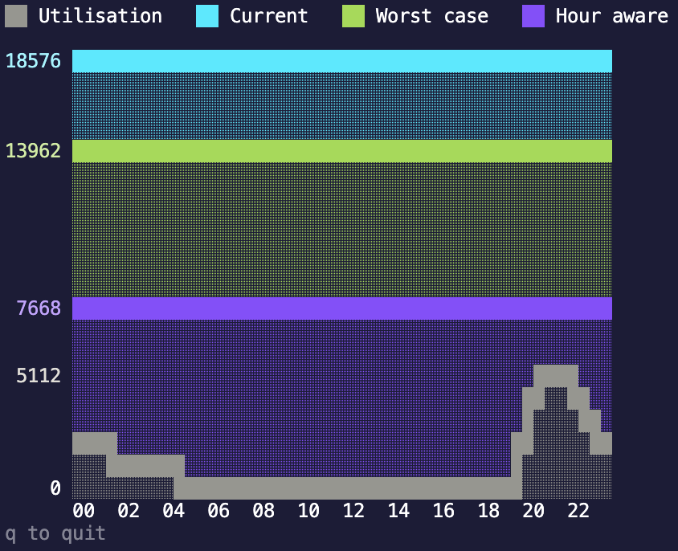
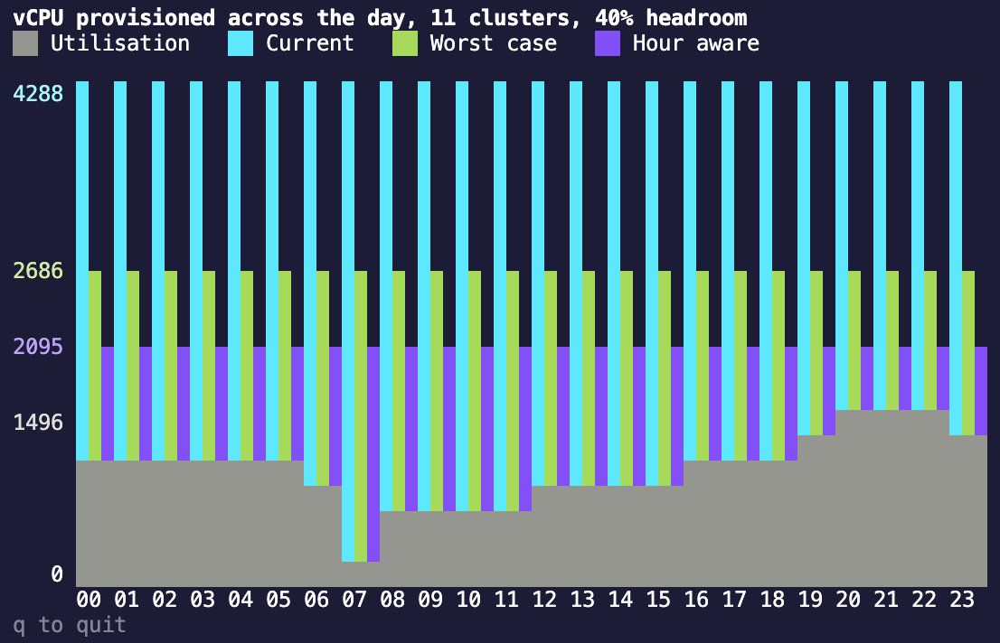
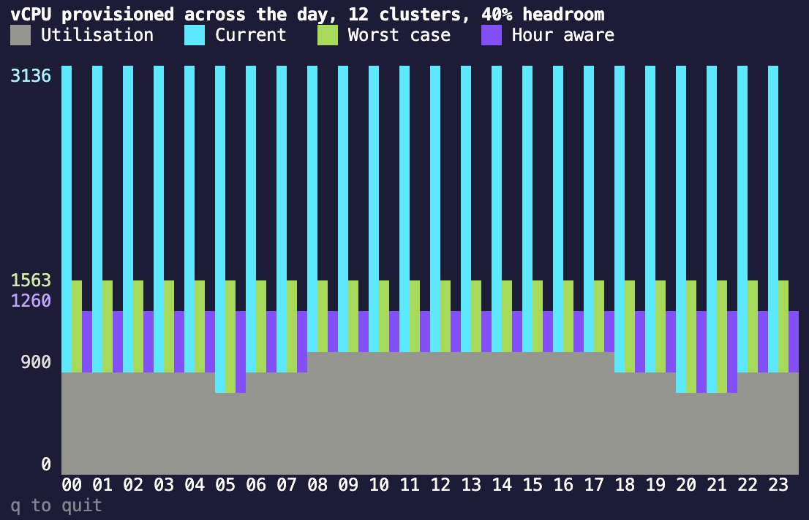
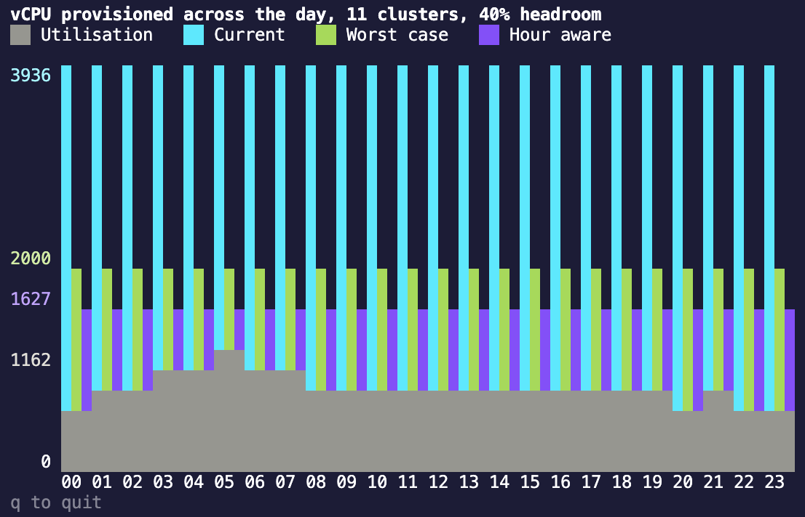
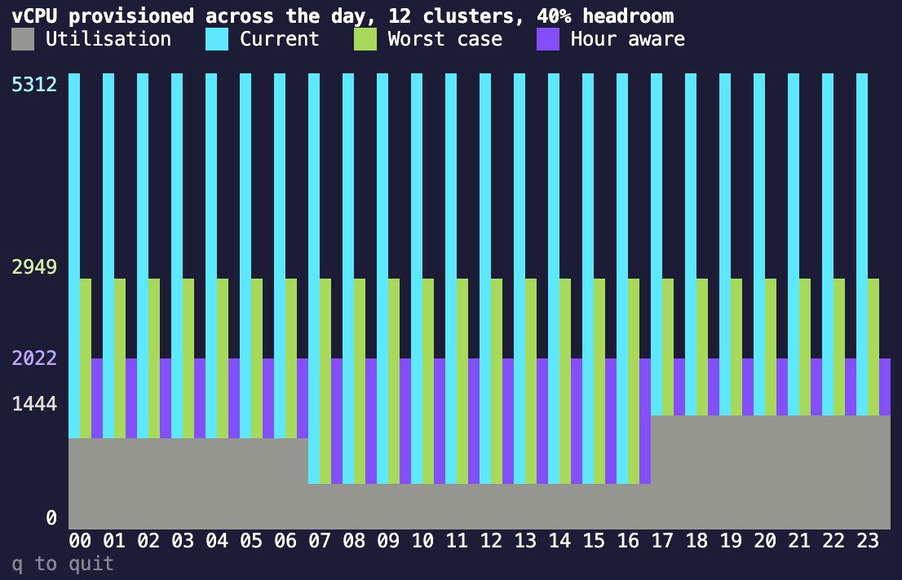
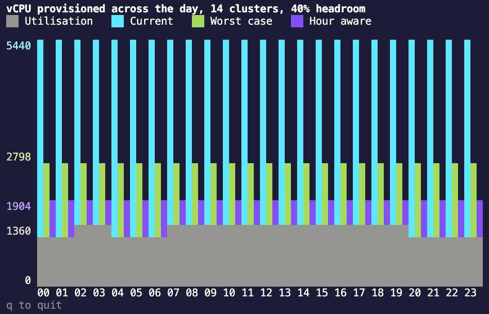
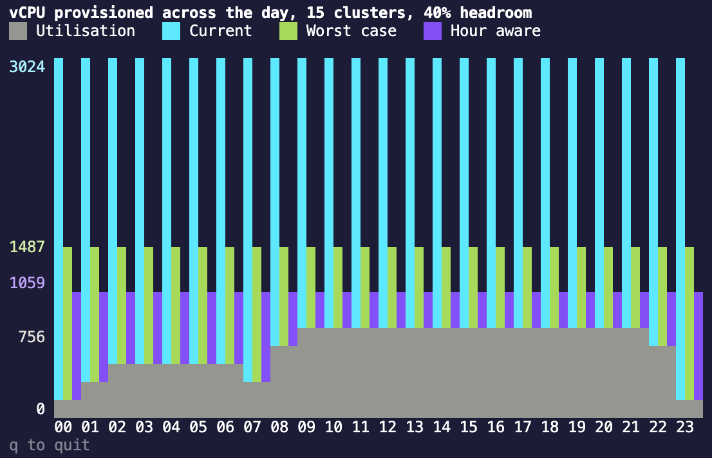
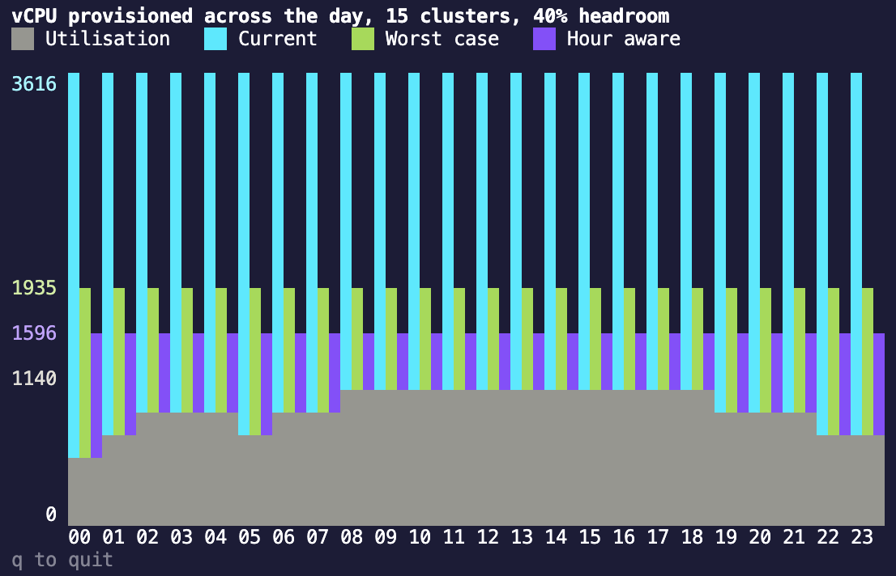
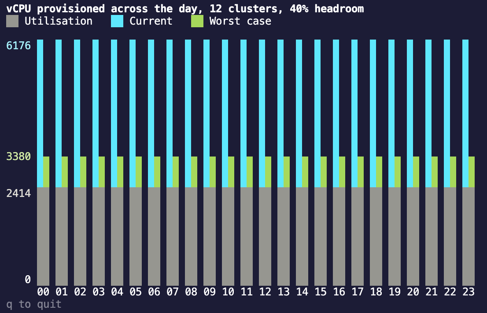
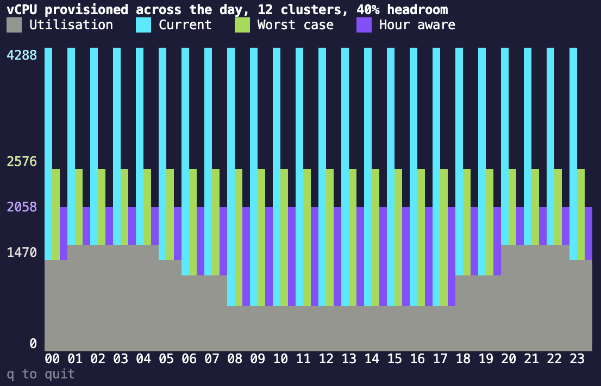

# u9n
A simple calculator that determines utilisation of a pre and post virtualised estate.

### Usage

```sh
u9n --config _examples/quant-fund.csv --headroom 20 --growth 15 --years 3 --profile
```

| Flag | Default | Description |
| --- | --- | --- |
| `--config` | | Path to the csv file containing cluster vcpu data. |
| `--headroom` | `20` | Percentage of spare capacity to add on top of peak utilisation. |
| `--growth` | `0` | Expected annual growth in vcpu demand, as a percentage. |
| `--years` | `1` | Number of years to compound growth over. |
| `--profile` | `false` | Print the hourly vcpu profile of the consolidated estate. |
| `--format` | `table` | Output format, one of `table`, `json` or `graph`. |

### Config

A csv file with one row per cluster. Column order doesn't matter.

| Column | Required | Description |
| --- | --- | --- |
| `name` | yes | Cluster name. Must be unique. |
| `provisioned_vcpu` | yes | vCPU the cluster has today. |
| `peak_vcpu` | yes | vCPU the cluster uses at peak. |
| `base_vcpu` | no | vCPU the cluster uses outside its peak window. Defaults to `0`. |
| `peak_from` | with `peak_to` | Hour the peak window opens, `0`-`23`. |
| `peak_to` | with `peak_from` | Hour the peak window closes, `0`-`24`. |

```csv
name,provisioned_vcpu,peak_vcpu,base_vcpu,peak_from,peak_to
crm-app,24,18,4,9,17
batch-etl,16,11,3,22,3
monitoring,6,6,6,0,0
```

Peak windows are half-open, so `9` to `17` covers 09:00 until 16:59. A window may wrap midnight (`22` to `3` covers 22:00 until 02:59), and a window whose bounds are equal covers the whole day. Omit `peak_from` and `peak_to` entirely and every cluster is treated as permanently at peak.

All hours are assumed to be in the same timezone. Normalise to UTC before writing the config if the estate spans regions.

### Output

Example with zero growth.

```sh
u9n --config _examples/quant-fund.csv --headroom 40

Clusters:          15
Provisioned vCPU:  726
Headroom:          40%
Peak diversity:    22.81%

               Current    Worst case    Hour aware
Required vCPU  726        369           285
Peak vCPU      263        263           203
Utilisation    36.23%     71.27%        71.23%
Peak hour      -          -             13:00
Saved vCPU     0 (0.00%)  357 (49.17%)  441 (60.74%)
```

Example with 15% growth every year for 3 years.

```sh
u9n --config _examples/quant-fund.csv --headroom 40 --growth 15 --years 3

Clusters:          15
Provisioned vCPU:  726
Headroom:          40%
Growth:            15% a year over 3 years (52.09% in total)
Peak diversity:    22.81%

               Current    Worst case    Hour aware
Required vCPU  726        560           433
Peak vCPU      263        263           203
Utilisation    36.23%     46.96%        46.88%
Peak hour      -          -             13:00
Saved vCPU     0 (0.00%)  166 (22.87%)  293 (40.36%)
```

**Current** is the status quo. It's sized by what's already racked rather than by demand, so headroom and growth don't move it. It's the baseline the savings are measured against, which is why it always saves nothing.

**Worst case** is the sum of every cluster's peak. It assumes they all peak at the same instant, whenever that is, so it has no peak hour.

**Hour aware** walks the 24 hour clock, adds up what every cluster draws in each hour, and takes the busiest. Without peak windows in the config every hour is identical, so the column repeats the worst case and the peak hour reads `00:00` because the first hour wins the tie.

**Peak diversity** is the share of the worst case total avoided by peaks falling in different hours. It's the consolidation win.

Required vCPU is the peak figure, grown by `--growth` compounded over `--years`, plus `--headroom`, rounded up.

Peak vCPU is always a peak and never an average, but which peak depends on the column. Current and worst case both add up every cluster's own peak. Hour aware takes the busiest single hour of the overlaid windows, which is why it's lower. Both are today's demand, so growth shows up in the required row only.

Utilisation is peak demand against the capacity that sizing stands up, not against today's estate. A consolidated sizing runs hotter than the estate it replaces, and that's the point - dividing by hardware you'd no longer own would hide it. Headroom is what holds the figure below 100%.

### Reading the result

Treat the two consolidated sizings as bounds, not as alternatives:

- **Worst case is the upper bound.** It assumes perfect correlation between clusters.
- **Hour aware is the lower bound.** It assumes the peak windows are exact and that jobs never overrun.

Peak windows are human estimates. A batch job that slips an hour collides with a window the model says it misses, so real demand sits between the two. Size above the hour aware figure unless the windows are backed by measurement.

Some things the tool deliberately doesn't model, each of which can move the answer more than headroom does:

- **Physical cores.** Output is vCPU. The core count to buy depends on the hypervisor's overcommit ratio.
- **Memory.** RAM usually binds before CPU in a consolidation.
- **The largest single cluster.** A VM can't span hosts, so no host can be smaller than the biggest cluster's peak.
- **Resilience.** One consolidated estate is one failure domain, with no N+1 reserve.
- **The calendar.** One representative day only, so no day-of-week, month-end or quarter-end peaks.
- **Hypervisor overhead.** The host OS and its storage and network services take their cut before any guest runs.

### Graph

`--format graph` opens a terminal chart of what each sizing provisions across the day. Press `q` to quit.



Every hour gets one bar per sizing: current (blue), worst case (green) and hour aware (purple). All three are flat across the day, because every sizing racks one capacity and holds it, the hour aware one included - it's sized by the busiest hour rather than by every cluster's peak at once, but the hardware still sits there the other 23 hours. The top of each bar is that sizing's required vCPU from the table.

What moves is the grey at the foot of the bars. That's utilisation, the demand the estate has to serve that hour, and the colour above it is capacity the sizing provisions but doesn't use. Utilisation is one curve rather than three, because the workload doesn't change with the way it's sized, so what separates the sizings is how much colour sits on top. The legend keys the grey separately from the three fills.

Without peak windows the hour aware sizing is the worst case, so only two bars are drawn rather than the same one twice.

The y axis is numbered at the top of each bar, in the colour of what it belongs to, plus a grey one for the busiest hour of the utilisation curve. Short terminals leave few rows to label, so where two of those fall in the same row the taller one takes the number.

The chart needs one column per sizing per hour plus the axis gutter, so around 78 columns. Below that it says so rather than wrapping the bars out of line with their hours.

### JSON

`--format json` emits the same figures plus per-cluster detail, for piping into other tools. The hourly profile is always included, so `--profile` affects table output only.

```sh
u9n --config _examples/quant-fund.csv --format json | jq '.scenarios[] | {key, required_vcpu}'
```

```json
{
  "clusters": 15,
  "provisioned_vcpu": 726,
  "headroom_percent": 20,
  "growth_percent": 0,
  "years": 1,
  "growth_factor": 1,
  "windowed": true,
  "peak_diversity_percent": 22.813688212927758,
  "scenarios": [
    {
      "key": "hour_aware",
      "label": "Hour aware",
      "peak_vcpu": 203,
      "utilisation_percent": 83.19672131147541,
      "peak_hour": 13,
      "required_vcpu": 244,
      "saved_vcpu": 482,
      "saved_percent": 66.39118457300276
    }
  ],
  "hourly": [{ "hour": 0, "vcpu": 85 }],
  "cluster_detail": [
    {
      "name": "crm-app",
      "provisioned_vcpu": 24,
      "peak_vcpu": 18,
      "base_vcpu": 4,
      "peak_from": 9,
      "peak_to": 17,
      "peak_hour_contribution_vcpu": 18
    }
  ]
}
```

`peak_hour` is null for sizings that aren't hour aware, and `peak_from`, `peak_to` and `peak_diversity_percent` are null when the config carries no peak windows. `peak_hour_contribution_vcpu` is what each cluster draws at the hour aware peak, which is how you find the clusters driving the number.

### Examples

u9n comes with 10 examples with varying workloads and peaks.

##### Game studio

Run with 40% headroom (tabular output)

```sh
u9n --config _examples/game-studio.csv --headroom 40
```

Output

```
Clusters:          11
Provisioned vCPU:  4288
Headroom:          40%
Peak diversity:    22.00%

               Current    Worst case     Hour aware
Required vCPU  4288       2686           2095
Peak vCPU      1918       1918           1496
Utilisation    44.73%     71.41%         71.41%
Peak hour      -          -              20:00
Saved vCPU     0 (0.00%)  1602 (37.36%)  2193 (51.14%)
```

Run with 40% headroom (graph output)



##### Hospital EHR

Run with 40% headroom (tabular output)

```sh
u9n --config _examples/hospital-ehr.csv --headroom 40
```

Output

```
Clusters:          12
Provisioned vCPU:  3136
Headroom:          40%
Peak diversity:    19.35%

               Current    Worst case     Hour aware
Required vCPU  3136       1563           1260
Peak vCPU      1116       1116           900
Utilisation    35.59%     71.40%         71.43%
Peak hour      -          -              08:00
Saved vCPU     0 (0.00%)  1573 (50.16%)  1876 (59.82%)
```

Run with 40% headroom (graph output)



##### Logistics fleet

Run with 40% headroom (tabular output)

```sh
u9n --config _examples/logistics-fleet.csv --headroom 40
```

Output

```
Clusters:          11
Provisioned vCPU:  3936
Headroom:          40%
Peak diversity:    18.63%

               Current    Worst case     Hour aware
Required vCPU  3936       2000           1627
Peak vCPU      1428       1428           1162
Utilisation    36.28%     71.40%         71.42%
Peak hour      -          -              05:00
Saved vCPU     0 (0.00%)  1936 (49.19%)  2309 (58.66%)
```

Run with 40% headroom (graph output)



##### Media streaming

Run with 40% headroom (tabular output)

```sh
u9n --config _examples/media-streaming.csv --headroom 40
```

Output

```
Clusters:          12
Provisioned vCPU:  5312
Headroom:          40%
Peak diversity:    31.43%

               Current    Worst case     Hour aware
Required vCPU  5312       2949           2022
Peak vCPU      2106       2106           1444
Utilisation    39.65%     71.41%         71.41%
Peak hour      -          -              18:00
Saved vCPU     0 (0.00%)  2363 (44.48%)  3290 (61.94%)
```

Run with 40% headroom (graph output)



##### Quant fund

A trading day that barely registers, followed by a nightly batch chain that runs the estate flat out. Each stage hands off to the next, so the grid that dominates the bill is idle for twenty one hours out of twenty four.

Run with 40% headroom (tabular output)

```sh
u9n --config _examples/quant-fund.csv --headroom 40
```

Output

```
Clusters:          15
Provisioned vCPU:  24000
Headroom:          40%
Peak diversity:    45.00%

               Current    Worst case      Hour aware
Required vCPU  24000      13054           7180
Peak vCPU      9324       9324            5128
Utilisation    38.85%     71.43%          71.42%
Peak hour      -          -               20:00
Saved vCPU     0 (0.00%)  10946 (45.61%)  16820 (70.08%)
```

The batch stages are staggered rather than concurrent, which is where the 45% peak diversity comes from, and it's also the assumption most worth testing. Run the same config with the stages overlapping and the hour aware figure converges on the worst case.

Run with 40% headroom (graph output)


##### Retail bank

Run with 40% headroom (tabular output)

```sh
u9n --config _examples/retail-bank.csv --headroom 40
```

Output

```
Clusters:          14
Provisioned vCPU:  5440
Headroom:          40%
Peak diversity:    31.93%

               Current    Worst case     Hour aware
Required vCPU  5440       2798           1904
Peak vCPU      1998       1998           1360
Utilisation    36.73%     71.41%         71.43%
Peak hour      -          -              02:00
Saved vCPU     0 (0.00%)  2642 (48.57%)  3536 (65.00%)
```

Run with 40% headroom (graph output)



##### Retail ecommerce

Run with 40% headroom (tabular output)

```sh
u9n --config _examples/retail-ecommerce.csv --headroom 40
```

Output

```
Clusters:          15
Provisioned vCPU:  3024
Headroom:          40%
Peak diversity:    28.81%

               Current    Worst case     Hour aware
Required vCPU  3024       1487           1059
Peak vCPU      1062       1062           756
Utilisation    35.12%     71.42%         71.39%
Peak hour      -          -              10:00
Saved vCPU     0 (0.00%)  1537 (50.83%)  1965 (64.98%)
```

Run with 40% headroom (graph output)



##### SaaS platform

Run with 40% headroom (tabular output)

```sh
u9n --config _examples/saas-platform.csv --headroom 40
```

Output

```
Clusters:          15
Provisioned vCPU:  3616
Headroom:          40%
Peak diversity:    17.51%

               Current    Worst case     Hour aware
Required vCPU  3616       1935           1596
Peak vCPU      1382       1382           1140
Utilisation    38.22%     71.42%         71.43%
Peak hour      -          -              15:00
Saved vCPU     0 (0.00%)  1681 (46.49%)  2020 (55.86%)
```

Run with 40% headroom (graph output)



##### Telco Core

Run with 40% headroom (tabular output)

```sh
u9n --config _examples/telco-core.csv --headroom 40
```

Output

```
Clusters:          12
Provisioned vCPU:  6176
Headroom:          40%

               Current    Worst case     Hour aware
Required vCPU  6176       3380           3380
Peak vCPU      2414       2414           2414
Utilisation    39.09%     71.42%         71.42%
Peak hour      -          -              00:00
Saved vCPU     0 (0.00%)  2796 (45.27%)  2796 (45.27%)
```

Run with 40% headroom (graph output)



##### University campus

Run with 40% headroom (tabular output)

```sh
u9n --config _examples/university-campus.csv --headroom 40
```

Output

```
Clusters:          12
Provisioned vCPU:  4288
Headroom:          40%
Peak diversity:    20.11%

               Current    Worst case     Hour aware
Required vCPU  4288       2576           2058
Peak vCPU      1840       1840           1470
Utilisation    42.91%     71.43%         71.43%
Peak hour      -          -              01:00
Saved vCPU     0 (0.00%)  1712 (39.93%)  2230 (52.01%)
```

Run with 40% headroom (graph output)

