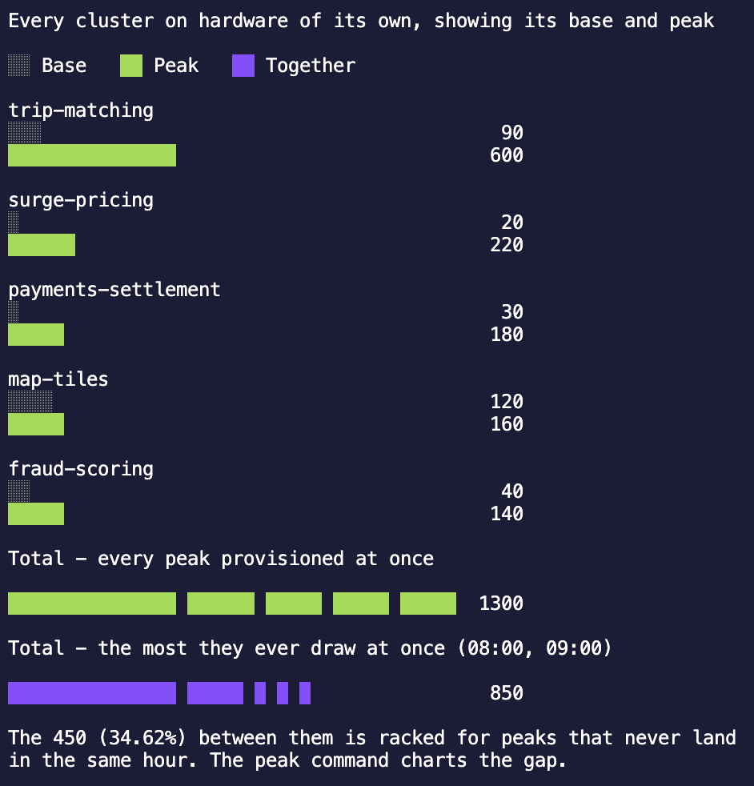

# u9n
Size for the peak of the sum, not the sum of the peaks.

If you run multiple workloads on separate hardware, you'll be sizing each of them independently (perhaps they're running on separate machines). To ensure that none of them run out of resources, you'll be sizing all of them for their worst day (or best day, depending on how you look at it).

Assume we're sizing for the following 3 workloads and ░░ represents base vCPU requirements and ██ represents peak vCPU requirements:

```text
Workload A
░░░░      4 vCPU
████████  8 vCPU

Workload B
░░░░░░░░      8 vCPU
████████████  12 vCPU

Workload C
░░                       2 vCPU
████████████████████████ 24 vCPU
```

In this model of provisioning, you need to ensure each application has enough resources, do your total provisioned capacity will be:

```text
Total

8 vCPU   12 vCPU      24 vCPU
████████ ████████████ ████████████████████████  44 vCPU
```

And that's no including the headroom of ~50% you'll give each to hedge against unexpected spikes... Realistically, we're looking at around 66 vCPUs to support these three workloads.

This model is called "sizing for the sum of the peaks"; we determine the peak of each workload (8 vCPU, 12 vCPU, and 24 vCPU) and we sum the peaks together.

When running on virtual hardware, however, a more efficient method emerges, allowing us to size for the peak of the sum instead.

This tool explores the differences between them and exposes the savings you might achieve through virtualisation. 

### Usage

Four subcommands, all reading the same csv.

| Command | What it answers |
| --- | --- |
| `u9n size` | How much vCPU the estate needs, sized three ways (what's racked today, the sum of the peaks, and the peak of the sum). |
| `u9n profile` | What the estate draws each hour of the day. |
| `u9n peak` | How much of the sum of the peaks is never drawn at once. |
| `u9n compare` | What each cluster costs on hardware of its own, and the total that comes to. |

#### size

```sh
u9n size --config _examples/ride-sharing.csv --headroom 40 --growth 15 --years 3
```

| Flag | Default | Description |
| --- | --- | --- |
| `--config` | | Path to the csv file containing cluster vcpu data. Required. |
| `--headroom` | `20` | Percentage of spare capacity to add on top of peak utilisation. |
| `--growth` | `0` | Expected annual growth in vcpu demand, as a percentage. |
| `--years` | `1` | Number of years to compound growth over. |
| `--format` | `table` | Output format, one of `table`, `json` or `graph`. |

<p align="center">
  
</p>

```text
Clusters:          5
Provisioned vCPU:  2400
Headroom:          40%
Growth:            15% a year over 3 years (52.09% in total)
Peak diversity:    34.62%

               Racked today  Sum of the peaks  Peak of the sum
Required vCPU  2400          2768              1810
Peak vCPU      1300          1300              850
Utilisation    54.17%        46.97%            46.96%
Peak hours     -             -                 08:00, 09:00
Saved vCPU     0 (0.00%)     -368 (-15.33%)    590 (24.58%)
```

**Racked today** is the status quo, sized by what's already racked rather than by demand, so headroom and growth don't move it. It's the baseline the savings are measured against.

**Sum of the peaks** is every cluster's peak added together. It assumes they all peak at the same instant, so it has no peak hour.

**Peak of the sum** walks the 24 hour clock, adds up what every cluster draws in each hour, and takes the busiest. Every hour tied for the busiest is listed. Without peak windows in the config every hour is identical, so the column repeats the sum of the peaks and the peak hours read `all day`.

**Peak diversity** is the share of the sum of the peaks avoided by peaks falling in different hours.

Required vCPU is the peak figure, grown by `--growth` compounded over `--years`, plus `--headroom`, rounded up. Peak vCPU is today's demand, so growth shows up in the required row only.

Utilisation is peak demand against the capacity that sizing stands up, not against today's estate. Headroom is what holds the figure below 100%.

Saved vCPU goes negative when a sizing asks for more than is already racked, as the sum of the peaks does above: at that headroom and that much growth, consolidating on the assumption every cluster peaks together would cost capacity rather than release it.

`--format graph` opens a terminal chart of what each sizing provisions across the day. Press `q` to quit. One line per sizing: racked today (blue), sum of the peaks (green) and peak of the sum (purple), each flat across the day at that sizing's required vCPU, because every sizing racks one capacity and holds it. The grey line along the bottom is utilisation, the demand the estate serves that hour, and the band between it and a sizing's line is capacity provisioned but not used.

The y axis is numbered at each line, in the colour of what it belongs to, plus a grey one for the busiest hour. Without peak windows the peak of the sum is the sum of the peaks, so only two lines are drawn. The chart needs around 30 columns.

`--format json` emits the same figures plus per-cluster detail, with the day included as one figure an hour.

```sh
u9n size --config _examples/ride-sharing.csv --format json | jq '.scenarios[] | {key, required_vcpu}'
```

```json
{
  "key": "racked_today",
  "required_vcpu": 2400
}
{
  "key": "sum_of_peaks",
  "required_vcpu": 1560
}
{
  "key": "peak_of_sum",
  "required_vcpu": 1020
}
```

`peak_hours` is null for every sizing but the peak of the sum, and `peak_from`, `peak_to` and `peak_diversity_percent` are null when the config carries no peak windows. `peak_hour_contribution_vcpu` is what each cluster draws at the first of the peak hours, which is how you find the clusters driving the number.

#### profile

```sh
u9n profile --config _examples/ride-sharing.csv --base --peak --format graph
```

| Flag | Default | Description |
| --- | --- | --- |
| `--config` | | Path to the csv file containing cluster vcpu data. Required. |
| `--base` | `false` | Show the vcpu the estate holds around the clock. |
| `--peak` | `false` | Show the vcpu the peak windows add on top of the base. |
| `--format` | `table` | Output format, one of `table`, `json` or `graph`. |

<p align="center">
  
</p>

The hours run 00:00 to 23:00. It isn't a sizing, so it carries no headroom and no growth.

**Base** is the vCPU every cluster holds whether or not it's working, the same in all 24 hours. **Peak** is what the clusters inside their peak window add on top. Together the two are that hour's total draw, so the busiest hour is the peak of the sum's peak vCPU from `size`. Dropping one of `--base` and `--peak` rescales the output rather than leaving a gap.

`--format table`, the default, prints a row an hour: an ascii bar scaled against the busiest hour of the day, the vCPU that hour draws, and a marker against every hour tied for the busiest.

```text
Hourly profile

00:00  ######################                    450
01:00  ######################                    450
02:00  ######################                    450
03:00  ######################                    450
04:00  ###############                           300
05:00  ###############                           300
06:00  ###############                           300
07:00  #######################################   810
08:00  ########################################  850 <- peak
09:00  ########################################  850 <- peak
10:00  ################                          340
11:00  ################                          340
12:00  ################                          340
13:00  ################                          340
14:00  ################                          340
15:00  ################                          340
16:00  ################                          340
17:00  ##########################                540
18:00  ##########################                540
19:00  ##########################                540
20:00  #############################             600
21:00  ###################                       400
22:00  ##########################                550
23:00  ######################                    450
```

`--format graph` draws the same day as a stacked bar a day wide, the base band under the peak band. The chart is 16 rows tall, so an hour just short of the peak would round into the same top row and read as a tie: the top row is kept for the busiest hours instead, and a `▼` over each of them says which they are. A day that draws the same in every hour has no busiest hour to point at, so it goes unmarked.

`--format json` emits each hour split into the two bands, for piping into other tools.

#### peak

```sh
u9n peak --config _examples/ride-sharing.csv
```

| Flag | Default | Description |
| --- | --- | --- |
| `--config` | | Path to the csv file containing cluster vcpu data. Required. |

<p align="center">
  
</p>

It charts the sum of the peaks against the peak of the sum. Like `profile` it draws demand rather than a sizing, so it carries no headroom and no growth: both numbers scale by the same factor under either, which moves them without moving the gap.

The top row is the sum of the peaks. The two under it are that same bar taken apart: the solid part is what the estate serves at its busiest hour, the shaded part is capacity bought for peaks that never land in the same hour (Avoided, the peak diversity from `size`).

Under it, every cluster is drawn as its own peak, biggest first, with the part it contributes at the peak hour filled in and the rest shaded. A row that's almost all shade is a cluster the consolidated estate never pays for twice. Where the day holds its peak for more than one hour, the rows are read off the first of them and a footnote says which hours those are.

Last is the same comparison across the whole day: in the quant fund the peak of the sum is 45.08% idle at 20:00 but 89.79% idle at 06:00, and 69.80% idle averaged over the 24 hours.

#### compare

```sh
u9n compare --config _examples/ride-sharing.csv
```

| Flag | Default | Description |
| --- | --- | --- |
| `--config` | | Path to the csv file containing cluster vcpu data. Required. |

<p align="center">
  
</p>

It draws the estate the way it's racked when every cluster gets hardware of its own: a cluster at a time, biggest peak first, each shown from the base it holds all day up to the peak its own hardware has to cover. Like `profile` and `peak` it draws demand, so it carries no headroom and no growth.

Every bar is drawn to one scale, the sum of the peaks, so the totals underneath are the bars above them laid end to end rather than bars in their own right. Each segment is a cluster, longest first so the row steps down evenly, and only the total carries a figure: the clusters print their own against their bars.

```text
Every cluster on hardware of its own, showing its base and peak

░░ Base   ██ Peak   ██ Together

Workload A
░░░░                                       4
███████                                    8

Workload B
░░░░░░░                                    8
███████████                               12

Workload C
░░                                         2
████████████████████                      24

Total - every peak provisioned at once

████████████████████ ███████████ ███████  44

Total - the most they ever draw at once (18:00, 19:00, 20:00, 21:00)

████████████████████ ███████ ████         36

The 8 (18.18%) between them is racked for peaks that never land
in the same hour. The peak command charts the gap.
```

The first total is the sum of the peaks, the number separate hardware has to stand up because no cluster can lend its idle capacity to another. The second is the peak of the sums: the same segments cut back to what each cluster draws in the hour they're busiest together, which is its own peak where its window covers that hour and the base it holds all day where it doesn't. Workload C is at peak at 18:00 and the other two are at their base, so the row comes up short of the one above it by the capacity only separate hardware pays for.

Each segment of the second total is cut out of the cells its cluster's peak was drawn with above, so the two rows are to the same scale and the length the second loses is the capacity shared hardware never stands up. Both rows are ordered by segment length rather than by cluster, so a cluster sitting at its base in that hour moves to the right of the smaller ones that are inside their window. A config with no peak windows has every cluster at peak in every hour, which makes the second total the first one over again, so it's left off along with the footnote.

One scale across the whole chart means a cluster that's a rounding error next to the biggest one comes out as a single cell, which is what it's worth to the total. It keeps that cell rather than vanishing, since it's still a cluster that needs hardware, and the vCPU column beside the bars carries the exact figures either way.

### Config

A csv file with one row per cluster. Column order doesn't matter.

| Column | Required | Description |
| --- | --- | --- |
| `name` | yes | Cluster name. Must be unique. |
| `provisioned_vcpu` | yes | vCPU the cluster has today. |
| `peak_vcpu` | yes | vCPU the cluster uses at peak. |
| `base_vcpu` | no | vCPU the cluster uses outside its peak window. Defaults to `0`. |
| `peak_from` | with `peak_to` | Hour the peak window opens, `0`-`23`. |
| `peak_to` | with `peak_from` | Hour the peak window closes, `0`-`24`. |

```csv
name,provisioned_vcpu,peak_vcpu,base_vcpu,peak_from,peak_to
trip-matching,1100,600,90,7,10
surge-pricing,420,220,20,17,21
payments-settlement,320,180,30,22,4
map-tiles,300,160,120,8,20
fraud-scoring,260,140,40,20,23

```

Peak windows are half-open, so `9` to `17` covers 09:00 until 16:59. A window may wrap midnight (`22` to `3` covers 22:00 until 02:59), and a window whose bounds are equal covers the whole day. Omit `peak_from` and `peak_to` entirely and every cluster is treated as permanently at peak.

All hours are assumed to be in the same timezone. Normalise to UTC before writing the config if the estate spans regions.

### Reading the result

Treat the two consolidated sizings as bounds, not as alternatives:

- **The sum of the peaks is the upper bound.** It assumes perfect correlation between clusters.
- **The peak of the sum is the lower bound.** It assumes the peak windows are exact and that jobs never overrun.

Peak windows are human estimates. A batch job that slips an hour collides with a window the model says it misses, so real demand sits between the two. Size above the peak of the sum unless the windows are backed by measurement.

Some things the tool deliberately doesn't model, each of which can move the answer more than headroom does:

- **Physical cores.** Output is vCPU. The core count to buy depends on the hypervisor's overcommit ratio.
- **Memory.** RAM usually binds before CPU in a consolidation.
- **The largest single cluster.** A VM can't span hosts, so no host can be smaller than the biggest cluster's peak.
- **Resilience.** One consolidated estate is one failure domain, with no N+1 reserve.
- **The calendar.** One representative day only, so no day-of-week, month-end or quarter-end peaks.
- **Hypervisor overhead.** The host OS and its storage and network services take their cut before any guest runs.

### Examples

u9n ships with 11 example configs in `_examples`, with varying workloads and peaks.

`ride-sharing.csv` is the smallest of them, five clusters picked to show every command off: a morning rush, an evening rush, an overnight batch whose window wraps midnight, a daytime service and a late evening one. They come to 1300 vCPU between them and 850 in the two hours they're busiest together, a peak diversity of 34.62%.
